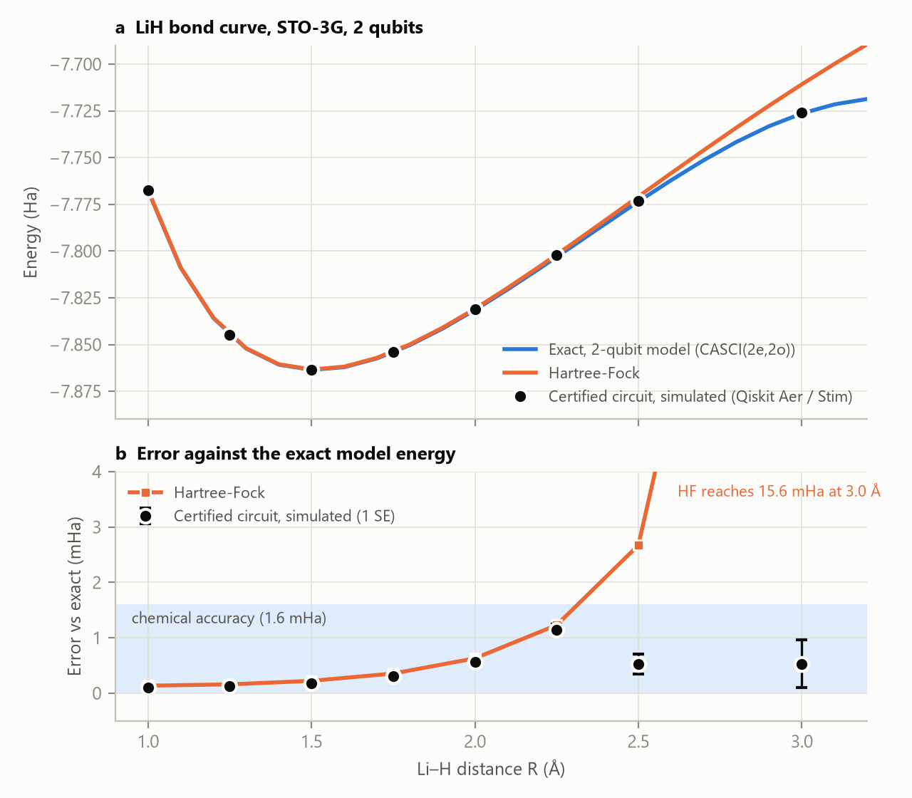

# Certified quantum circuits for a chemical bond

An [AI workflow on AgentPMT](https://www.agentpmt.com/agent-workflow-skills/replicate-and-certify-a-quantum-chemistry-result-exact-gate-bond-curves-with-lean-proofs) found a 2026 arXiv paper on lithium hydride and independently re-derived its energies. It showed that the paper's reported ground state is the Hartree-Fock energy, 22 mHa above the exact answer. It then mapped the LiH bond curve with quantum circuits whose exact unitaries are proven by the Lean kernel, simulated in Qiskit Aer and Stim, and exported as runnable OpenQASM 3 and Qiskit programs.

This repo holds everything the run produced: the workflow itself, every circuit, certificate, receipt, simulation count, exported program and figure, and the scripts that reproduce the numbers.

## Run it yourself

1. **Sign up for a free AgentPMT account** at [agentpmt.com](https://www.agentpmt.com).
2. **Connect your AI agent to AgentPMT over MCP** by following the instructions at [agentpmt.com/dynamic-mcp](https://www.agentpmt.com/dynamic-mcp).
3. **Ask your agent to run the workflow** [*Replicate and Certify a Quantum Chemistry Result: Exact-Gate Bond Curves with Lean Proofs*](https://www.agentpmt.com/agent-workflow-skills/replicate-and-certify-a-quantum-chemistry-result-exact-gate-bond-curves-with-lean-proofs). Give it a molecule, a topic or an arXiv ID, for example:

   > Run the "Replicate and Certify a Quantum Chemistry Result" workflow on recent LiH papers.

   You can also chat with the public **Quantum Circuit Building Agent** on AgentPMT, which already has the workflow, its tools and its context documents attached.

   The workflow finds papers, reproduces their chemistry and builds the bond curve. It simulates, exports and certifies the circuits, and saves the report and certificates to your AgentPMT files. The two context documents it relies on are public on AgentPMT (copies are in [`context/`](context/)). Paper searches go through your own Valency connection.

## Headline results

- **Replication.** arXiv [2606.05968v1](https://arxiv.org/abs/2606.05968v1) reports -7.857385 Ha as the FCI-limit ground state of LiH at 1.696 A ((2e,5o), Bravyi-Kitaev, 10 qubits).
  - **Basis.** The paper omits it. We assume STO-3G, which is strongly supported because all four components of the paper's energy breakdown match the STO-3G Hartree-Fock values to within 7e-7 Ha.
  - **The reported number is Hartree-Fock.** Under that assumption, it is the restricted Hartree-Fock energy (-7.857384707 Ha). The exact ground state of the stated active space is -7.879357455 Ha, **21.97 mHa lower**.
  - **The reference state is wrong.** Decoded explicitly under standard encodings, the stated reference `|1111000000>` is not the Hartree-Fock state. Under the Bravyi-Kitaev convention the tool itself uses, it is a 4-electron determinant. The exact implementation error is not established.
  - [Details](paper-replication/replication_table.md). The paper itself is included as [`paper-replication/2606.05968v1.pdf`](paper-replication/2606.05968v1.pdf), so you can check every number against the source.
- **Bond curve.** 8 bond lengths from 1.0 to 3.0 A, **every point backed by an axiom-free Lean certificate** of the circuit's exact unitary. All simulated energies are within chemical accuracy (1.6 mHa) of exact, the largest error being 1.15 mHa. They also agree with each circuit's exact energy within shot noise (|z| <= 1.07).
- **Certified Clifford+T synthesis.** Where Hartree-Fock misses by 15.6 mHa (3.0 A), a 47-gate Clifford+T circuit with 17 T gates lands 0.53 mHa from exact in simulation, and 0.066 mHa noise-free. The synthesis runs as one Complex Mathematics Engine expression in 0.12 s.

## Read more

- [The workflow on AgentPMT](https://www.agentpmt.com/agent-workflow-skills/replicate-and-certify-a-quantum-chemistry-result-exact-gate-bond-curves-with-lean-proofs): the live, public workflow
- [`PAPER.md`](PAPER.md): the one-page summary
- [`HOW_IT_WORKS.md`](HOW_IT_WORKS.md): the full test run, step by step, with every tool call's role and result
- [`RESEARCH_NOTES.md`](RESEARCH_NOTES.md): the lab notebook: how we built the workflow, what each tool does, and every design decision
- [`results/REPORT.md`](results/REPORT.md): the report the workflow produced
- [`workflow/WORKFLOW.md`](workflow/WORKFLOW.md): the workflow exported as markdown

## Layout

| Folder | Contents |
|---|---|
| `workflow/` | Workflow graph (`workflow.json`), markdown export, Clifford+T engine expression builder |
| `context/` | The two public Agent Context documents the workflow uses |
| `paper-replication/` | Valency search results, extracted paper inputs, replication table |
| `hamiltonians/` | Chemistry Studio qubit Hamiltonians (10-qubit BK model; 2-qubit bond-curve model) |
| `circuits/` | Lean and IR sources for every circuit, the generators, synthesis reports |
| `simulations/` | All execution receipts: counts, backend, versions, seeds |
| `exports/` | OpenQASM 3 and Qiskit programs (exact readback checked) |
| `certificates/` | qpcert files (SHA-256 verified) and certification receipts |
| `results/` | Reference curves, precision budget, energies, report and data |
| `figures/` | Figures and the script that draws them |

## Tools

Valency Research Paper Library, Live Web Page Browser, Chemistry Studio, Complex Mathematics Engine, Quantum Circuit Builder with Proof (PCQ service 0.2.0, HeytingLean on Lean 4.24) and File Management, all on AgentPMT.
