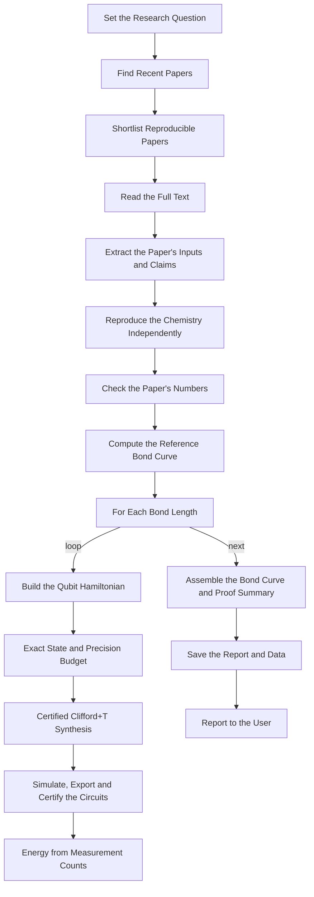

# Replicate and Certify a Quantum Chemistry Result: Exact-Gate Bond Curves with Lean Proofs

Finds recent quantum-chemistry papers with Valency, rebuilds the reported molecule in Chemistry Studio and checks the paper's numbers (geometry, reference state, energies) against exact calculations. It then models the chemical bond as a potential energy curve with exact-gate quantum circuits. For each bond length it runs a classical precision budget (how finely rotation angles must be set to reach chemical accuracy), synthesizes an exact Clifford+T circuit in the Math Engine wherever the angles need finer phases, runs a Qiskit Aer simulation with energies from measurement counts, exports OpenQASM 3 and Qiskit programs, and issues Lean-kernel certificates (qpcert) for every circuit on the curve. The report states exactly what is proven (circuit properties) and what is not (the chemistry). Built for replication studies, method papers and teaching, using molecules such as LiH.

**Platform:** AgentPMT workflow (skill chain) `6ada7c48e001971070f3313a`, published publicly as v1.1.1 (same steps as v1.1.0).
**Attached context documents** (copies in `../context/`):
- Proof-Carrying Quantum Chemistry Rules (Agent Context `6ada6b06e001971070f32fc7`)
- Certified Clifford+T Synthesis for Exact-Gate Chemistry Circuits (Agent Context `6ada99f0e001971070f333a0`)

## Tools

- **Valency Research Paper Library** (`6ada7145e001971070f33005`)
- **Live Web Page Browser** (`69644454288e0324fa542102`)
- **Chemistry Studio** (`6ada6971e001971070f32f9a`)
- **Complex Mathematics Engine** (`689df4ac8ee2d1dd79e9035b`)
- **Quantum Circuit Builder with Proof** (`6a7e5036b8c970a6773201b5`)
- **File Management** (`6948b078b54506f955d789ed`)

## Steps

### 1. Set the Research Question

*Reasoning step*

**Goal:**

Turn the user's request into a concrete replication target and literature search plan.

**Inputs:**

The user's message. It may name a molecule or topic, a paper ID, a recency window or a bond-length range.

**Outputs:**

A short plan with these items:
- the molecule(s)
- 2-3 search queries
- the date window (default: last 12 months)
- sources (default: arxiv and chemrxiv)
- any paper ID the user supplied
- the bond-length range if the user gave one

**Constraints:**

Follow the attached context document 'Proof-Carrying Quantum Chemistry Rules'. Never invent paper IDs, geometries or numbers. Circuits are limited to 4 qubits or fewer. Classical replication may use larger active spaces.

**Success criteria:**

The plan is specific enough to run the search without asking again.

### 2. Find Recent Papers

*Tool: Valency Research Paper Library*

If the user supplied a paper ID, call get_paper_by_id. Otherwise call semantic_search_papers once per query with start_date set to the plan's window, limit 25, include_abstract true, enrich_citations false and max_authors 5. Add one search_by_abstract call with the molecule name. Keep id, title, first-available date, source, url and abstract for each paper, and pass them to the shortlist step.

### 3. Shortlist Reproducible Papers

*Reasoning step*

**Goal:**

Choose up to 3 papers whose small-molecule electronic-structure result can be reproduced and checked.

**Inputs:**

Valency results (titles, abstracts, dates, ids).

**Outputs:**

A ranked shortlist with a one-line reason for each paper and the chosen paper to work on.

**Constraints:**

Prefer papers that report:
- a molecule and its bond length(s)
- a basis set, active space and qubit mapping
- numerical energies

Prefer recent papers. Show the shortlist to the user and continue with the top paper unless the user picks another.

**Success criteria:**

Exactly one paper is selected, and the reason is stated.

### 4. Read the Full Text

*Tool: Live Web Page Browser*

For arXiv papers, call get_url_markdown on https://arxiv.org/html/<id with version>. For other sources, use the url from Valency. If no HTML version exists, say so and fall back to the abstract page. Appendices may hold run logs encoded in base64. Read them, because they often contain the exact reference state and settings.

### 5. Extract the Paper's Inputs and Claims

*Reasoning step*

**Goal:**

Extract everything needed to reproduce the paper's chemistry, and every numerical claim to check.

**Inputs:**

Full text of the chosen paper.

**Outputs:**

A table of the following, with each item marked as stated, inferred (with reason) or missing:
- molecule, charge and multiplicity
- geometry and every bond length (Angstrom)
- basis set
- frozen core, active electrons and active orbitals
- fermion-to-qubit mapping, spin order and tapering
- qubit count
- reference-state bitstring
- ansatz
- reported energies, and which constants they include

**Constraints:**

Do not guess silently. A missing basis may be inferred only from orbital and qubit counts, and the inference must be stated.

**Success criteria:**

Chemistry Studio can be called with the paper's settings.

### 6. Reproduce the Chemistry Independently

*Tool: Chemistry Studio*

1. Call build_hamiltonian with the paper's geometry, basis, active space, mapping and spin order. Keep qubits, hf_state.bitstring, hf_energy_hartree, exact_energy_hartree and constant_hartree.
2. Call calculate_energy with method hf, then casci (same active space), then fci when the molecule is small, as cross-checks.
3. If the basis was inferred, also run the plausible alternatives and report which one matches the paper's numbers.
4. Poll get_task (wait_seconds 55) for anything that returns status processing.

### 7. Check the Paper's Numbers

*Reasoning step*

**Goal:**

Compare the paper's claims with the independent reproduction, then choose the circuit model for the bond curve.

**Inputs:**

Extracted claims and Chemistry Studio results.

**Outputs:**

1. A replication table: quantity, paper value, reproduced value, difference (mHa for energies) and verdict.
2. A findings paragraph with caveats.
3. The circuit model, which must be 4 qubits or fewer.
   - Default: the paper's molecule in a 2-electron, 2-orbital active space with mapping parity_tapered (2 qubits), the minimal model of a sigma bond.
   - Bond lengths: 8 points from about 0.6x to 2.5x the equilibrium bond length, or the paper's own bond lengths if it reports a curve.

**Constraints:**

Flag these:
- any energy difference of 1.6 mHa (chemical accuracy) or more
- any reference bitstring that is not the Hartree-Fock state under the stated mapping
- any energy components that do not sum to the reported total

State inferences as inferences. Say that the circuit model is a reduced model when it differs from the paper's.

**Success criteria:**

Every reported number in the paper is either matched, flagged, or marked as not checkable.

### 8. Compute the Reference Bond Curve

*Tool: Chemistry Studio*

Call scan_bond for the chosen molecule over the chosen range with method fci (or casci with the circuit model's active space, if fci exceeds limits), using the circuit model's basis. Keep each point's energy and the lowest point. Also run method hf for the same range, so the curve shows the correlation energy.

### 9. For Each Bond Length

*Loop over `point`*

Process each bond length of the circuit model in order. Run quantum tool jobs one at a time.

  #### 10. Build the Qubit Hamiltonian (inside the loop)

  *Tool: Chemistry Studio*

Call build_hamiltonian for this bond length with the circuit model settings: basis, active_electrons, active_orbitals, mapping parity_tapered and pauli_format sparse. Keep the terms, the hf_state bitstring, hf_energy_hartree and exact_energy_hartree.

  #### 11. Exact State and Precision Budget (inside the loop)

  *Tool: Complex Mathematics Engine*

Run one numpy calculate expression: the precision-budget template in the context document 'Proof-Carrying Quantum Chemistry Rules' (section 12), with HAMILTONIAN_SUM built from this bond length's terms. It must:
1. Build the 4x4 Hamiltonian with np.kron (qubit 0 = left factor).
2. Take np.linalg.eigh and the ground state.
3. Compute the exact real state-preparation angles t0, alpha and beta.
4. For K = 2..10, compute the integer multiples m of 2*pi/2^K and the energy error dE_K in mHa.

The exact energy must equal Chemistry Studio's exact_energy_hartree to 1e-9 Ha. Choose K* as the smallest K for which this K and every finer K are within 1.6 mHa.

  #### 12. Certified Clifford+T Synthesis (inside the loop)

  *Tool: Complex Mathematics Engine*

Run this step only when K* >= 5 (some angle needs a phase finer than 2*pi/16, which certify_circuit does not accept). When K* <= 4, record 'not needed' and continue.
Run one numpy calculate expression: the template in the context document 'Certified Clifford+T Synthesis for Exact-Gate Chemistry Circuits', with HAMILTONIAN_SUM built exactly as in the precision-budget step. It returns [E0, [t0, alpha, beta], E_circuit, dE_mHa, [q0_U0, q1_Ua, q1_Ub], front].
Check that E0 equals the precision budget's exact energy to 1e-9 Ha and that dE_mHa is below 1.6. Keep the three gate lists, E_circuit, dE_mHa, the T count, the gate count (all gates plus 2 CX) and the T-count front for the report.

  #### 13. Simulate, Export and Certify the Circuits (inside the loop)

  *Tool: Quantum Circuit Builder with Proof*

Choose the certified circuit for this bond length:
- K* <= 4: the dyadic state preparation at K*: Ry(t0) on q0, Ry(alpha) on q1, CX(0,1), Ry(beta) on q1, CX(0,1), each Ry written as Sdg, H, P, H, S with P expanded in binary into Z, S, T and rzk phases (rules document, sections 4 and 11).
- K* >= 5: the Clifford+T gate lists from the synthesis step: q0_U0 on q0, q1_Ua on q1, CX(0,1), q1_Ub on q1, CX(0,1), profile exact_clifford_t_v2.
If the certified circuit is gate-for-gate identical to one already run at another bond length (for example the Hartree-Fock circuit), reuse its counts, programs and certificate.
Then, one job at a time, with resource_class standard:
1. execute_locally, shots 65536, for four Lean circuits: the state prep followed by the measurement bases ZZ, XX (H on both qubits), ZX (H on q1) and XZ (H on q0).
2. export_provider_programs for the state prep, targets openqasm3 and qiskit_python.
3. inspect_circuit on the IR twin (add image_format png only when the circuit has 20 operations or fewer), then certify_circuit with a well_formed claim and an exact_unitary_action claim bound to its circuit_subject_sha256.
4. When K* >= 5, also simulate and export the dyadic K* circuit as the precision-study comparison.

Poll get_task with wait_seconds 60. Completed tasks return result_file (and certificate_file): download each JSON from its signed_url and read result.result. Retry a timed-out or HTTP 5xx job once as a new task. Never resubmit a processing task.

  #### 14. Energy from Measurement Counts (inside the loop)

  *Reasoning step*

**Goal:**

Turn the four sets of counts into an energy with a standard error, and compare it with the exact prediction.

**Inputs:**

Counts from ZZ, XX, ZX and XZ for each simulated circuit, the Hamiltonian terms, and each circuit's exact energy (E(theta_K*) from the precision budget, or E_circuit from the Clifford+T synthesis).

**Outputs:**

One row for this bond length:
- bond length
- HF and exact energies
- for each simulated circuit: its exact energy, simulated energy +/- SE and z-score
- K*
- the certified circuit: kind (dyadic or Clifford+T), gate count, T count, rzk count
- certificate file_id and certified claim ids
- export file ids

Include any anomaly.

**Constraints:**

Count keys put qubit 0 leftmost. Compute 
 as the sum of (-1)^(parity on the support of P) * count / shots. Flag a difference from the circuit's exact energy larger than 3 SE. Simulation is evidence, not proof.

**Success criteria:**

The row is complete, and any flag is explained.

### 15. Assemble the Bond Curve and Proof Summary

*Reasoning step*

**Goal:**

Combine all bond lengths into the result of the study.

**Inputs:**

Every point row, the reference curve, and the replication table.

**Outputs:**

A markdown report containing:
- the replication findings
- a bond-curve table (HF, exact, circuit-simulated energies)
- the equilibrium bond length and dissociation energy, from both the exact and the simulated curve
- the precision budgets: the dyadic table (K* and dE_K by bond length) and, where used, the Clifford+T T-count front
- a certificates table (circuit, kind, gates, T count, certificate id, certified claims)
- a 'What is proven / what is not' section

Also produce a JSON data file with all numbers.

**Constraints:**

A qpcert proves circuit properties, never energies. Report which claims were kernel-certified: under exact_clifford_t_v2 the exact unitary is kernel-certified; under exact_cyclotomic_2k_v1 exact_unitary_action is exact-evaluated but not kernel-replayed.

**Success criteria:**

Every number in the report traces to a tool output.

### 16. Save the Report and Data

*Tool: File Management*

Upload the markdown report and the JSON data file. Extend the expiration of every qpcert, exported program and Hamiltonian file created in this run, so they outlive the 7-day default. List all file ids for the final report.

### 17. Report to the User

*Reasoning step*

**Goal:**

Give the user a concise summary and the files.

**Inputs:**

Assembled report and file ids.

**Outputs:**

A short summary covering:
- the paper and replication verdict
- the bond-curve headline numbers
- the precision budget
- what is proven and what is not
- links to the saved files

**Constraints:**

No claims of quantum advantage or new chemistry. Quote failures and rejections verbatim.

**Success criteria:**

The user can cite the files and reproduce every number.

## Graph

